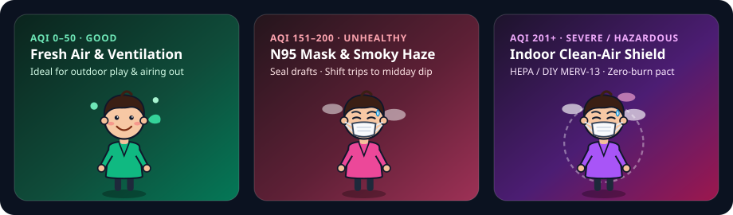

<div align="center">

# 🛡️ AirShield AI — Urban Air Quality & Winter Smog Assistant

**PromptWars Challenge 6 Submission** · GenAI-powered full-stack web application helping families and communities navigate severe winter smog and urban air pollution with low-emission daily routines, indoor air quality hacks, sustainable alternatives, and transparent impact quantification.

[](https://www.typescriptlang.org/)
[](https://react.dev/)
[](https://expressjs.com/)
[](./SECURITY.md)
[](#accessibility--inclusive-design)
[](#testing--verification)

</div>

---

## 📸 Live Dashboard & Mascot Preview


### 🎭 Dynamic AirShield AI Mascot States
The built-in vector mascot (`src/components/AqiMascotSvg.tsx`) reacts dynamically to real-time air quality severity so families—including kids and seniors—can understand air risk at a single glance alongside explicit text labels and numeric AQI ranges:



---

## ✨ Core Features (Problem Statement Alignment)

| Capability | How It Helps Families & Communities |
| --- | --- |
| **🔴 Real-Time Live AQI & Weather Stream (SSE)** | Streams live US AQI, PM2.5, PM10, NO₂, O₃, CO, Temperature, Humidity, Wind Speed, and UV Index via Open-Meteo APIs + Server-Sent Events (`/api/air-quality/stream`) with pause/resume controls, saved favorite cities, and offline resilience. |
| **🗺️ Hyperlocal Interactive `AQI Map`** | Pure-SVG neighborhood station map highlighting localized micro-environments (Residential, School Corridor, Arterial Highway, Industrial Ring, Green Park) and surfacing the **cleanest nearby zone** for errands or walks. |
| **⏰ Safest 2-Hour Window & Inversion Risk** | Analyzes 24-hour forecasts to pinpoint the lowest-PM2.5 window for school runs or brief cross-ventilation and flags **Winter Thermal Inversion** trapping hours. |
| **👨‍👩‍👧‍👦 Household & Community Profiler** | Tailors every plan to household size, vulnerable members (infants, kids, seniors, asthma/COPD, pregnant members), home type, HEPA ownership, cooking fuel, commute mode & distance, budget tier, and role (Family, School PTA, Neighborhood RWA). |
| **🤖 GenAI Action Plan & Smog Advisor Chat** | Powered by **Google Gemini (`gemini-2.5-flash`)** structured JSON output with automatic fallback to the offline **AirShield Local Domain Engine**. Delivers **Low-Emission Routines**, **Indoor Air Hacks** (including DIY Corsi-Rosenthal MERV-13 filter steps), **Sustainable Swaps**, **Community Actions**, and a copyable/printable **Neighborhood & School Smog Alert**. |
| **📊 Direct Choice & Community Impact Simulator** | Quantifies multiplicative PM2.5 inhalation reduction, estimated indoor PM2.5 drop, avoided cigarette-equivalents/month, and scales emissions savings (`kg CO₂`, `kg PM2.5`, equivalent urban trees, and monthly budget impact) from **1 family to 1,000 households**. |

---

## 🏗️ System Architecture

```text
┌────────────────────────────────────┐      REST + Live SSE      ┌──────────────────────────────────────┐
│    React 19 + TypeScript + Vite    │ ◄───────────────────────► │      Express 5 + TypeScript API      │
│  • Dark / Light / High-Contrast    │                           │  • Helmet CSP + Permissions-Policy   │
│  • Pure-SVG Forecast & AQI Map     │                           │  • Strict CORS + 16 KB Body Limit    │
│  • Dynamic Vector Mascot           │                           │  • Zod Validation + Rate Limiter     │
└────────────────────────────────────┘                           └──────────────────┬───────────────────┘
                                                                                    │
                                             ┌──────────────────────────────────────┼──────────────────────────────────────┐
                                             ▼                                      ▼                                      ▼
                                  ┌─────────────────────┐                ┌─────────────────────┐                ┌─────────────────────┐
                                  │ TtlLruCache +       │                │ AirQualityService   │                │ AiAdvisorService    │
                                  │ Request Coalescing  │                │ Open-Meteo AQ +     │                │ Gemini GenAI JSON + │
                                  │ (Zero Stampedes)    │                │ Weather + Stations  │                │ Injection Firewall  │
                                  └─────────────────────┘                └─────────────────────┘                └─────────────────────┘
```

---

## 🚀 Quick Start

### Prerequisites
- **Node.js `>= 20.0.0`** (verified on Node.js 24)

### 1. Clone & Install
```bash
git clone https://github.com/newcoder-available/-PromptWars_Challenge-6-_Urban_Air_Quality_Assistant.git
cd -PromptWars_Challenge-6-_Urban_Air_Quality_Assistant
npm install
```

### 2. Configure Environment (Optional for Live Gemini)
```bash
cp .env.example .env
```
Edit `.env` if you want to enable live Google Gemini responses:
```env
PORT=3001
ALLOWED_ORIGINS=http://localhost:5173,http://127.0.0.1:5173
GEMINI_API_KEY=your_gemini_api_key_here
GEMINI_MODEL=gemini-2.5-flash
OFFLINE_MODE=false
```
> **Zero-Setup Demo Friendly:** If `GEMINI_API_KEY` is left blank, AirShield AI automatically runs its deterministic **Local Domain Engine**, so every dashboard widget, tailored plan, simulator calculation, and advisor chat works immediately out of the box.

### 3. Run in Development Mode
```bash
npm run dev
```
- **Web App:** `http://localhost:5173`
- **API Server:** `http://127.0.0.1:3001`

### 4. Production Build & Start
```bash
npm run build
NODE_ENV=production npm start
```

### 5. Deploy on Vercel (One-Click Ready)
This repository includes [vercel.json](./vercel.json) and a serverless Express entrypoint ([api/index.ts](./api/index.ts)) pinned to Node `22.x`:
1. Import the GitHub repository into **Vercel** (Framework Preset: `Vite`, auto-configured via `vercel.json`).
2. *(Optional)* Add `GEMINI_API_KEY` under **Project Settings → Environment Variables** for live Google Gemini responses (without it, the built-in Local Domain Engine runs automatically).
3. Deploy — Vercel serves the React SPA from `dist/client` and routes all `/api/*` requests to `api/index.ts`.

### 6. Secure Docker Deployment
```bash
docker build -t airshield-ai .
docker run -p 8080:8080 \
  -e ALLOWED_ORIGINS=http://localhost:8080 \
  -e GEMINI_API_KEY=your_gemini_api_key_here \
  airshield-ai
```

---

## 🔌 REST & Live Streaming API Reference

| Method | Endpoint | Description |
| --- | --- | --- |
| `GET` | `/api/health` | Service readiness, active AI engine mode, and LRU cache telemetry |
| `GET` | `/api/cities/presets` | Curated winter-smog hotspot cities |
| `GET` | `/api/cities/search?q=<city>` | Validated global city geocoding lookup |
| `GET` | `/api/air-quality?lat=&lon=&name=&country=` | Live AQI, weather, hyperlocal stations, safest window & inversion risk |
| `GET` | `/api/air-quality/stream?lat=&lon=...` | Real-time **Server-Sent Events (SSE)** live update stream |
| `POST` | `/api/advisor/plan` | Personalized GenAI action plan + direct health/community impact |
| `POST` | `/api/advisor/chat` | Context-grounded GenAI advisor chat with prompt-injection firewall |
| `POST` | `/api/impact/simulate` | Quantitative household & community emissions/exposure simulator |

---

## 🔐 Security & Efficiency Highlights

- **Defense-in-Depth Security** (full threat model in [SECURITY.md](./SECURITY.md)):
  - Helmet strict CSP (`default-src 'self'`, `script-src 'self'`, `object-src 'none'`, `frame-ancestors 'none'`), `Permissions-Policy`, `X-Powered-By` stripped.
  - Strict `ALLOWED_ORIGINS` CORS allowlist (`403` on untrusted origins).
  - Zod schema validation on all inputs **and** GenAI JSON outputs, ASCII control-character sanitization, `16kb` JSON payload cap (`413`), and memory-bounded sliding-window rate limiting (`429` + `Retry-After`).
  - Prompt-injection detector & XML delimiter sandboxing (`<user_question>`, `<user_focus_note>`), SSRF host allowlist with timeouts, server-side-only API key handling (`x-goog-api-key` header), and non-root multi-stage `Dockerfile`.
- **Resource Efficiency**:
  - Bounded **LRU + TTL caching** with **in-flight request coalescing** eliminates duplicate upstream requests and cuts GenAI token spend.
  - Coordinate grid rounding (`~1.1 km`), gzip response compression, and zero heavy charting/mapping library bloat (`~90 kB` gzipped client JS total).

---

## ♿ Accessibility & Inclusive Design

- **WCAG 2.1 AA** compliant layout with skip-to-main-content link, semantic HTML5 landmarks, and high-visibility `:focus-visible` outlines.
- **Dark**, **Light**, and **High-Contrast** theme toggles plus `prefers-reduced-motion` animation suppression.
- Color-blind safe AQI indicators (always paired with explicit text labels, icons, and numeric ranges) and an **expandable accessible HTML data table** backing the 24-hour SVG forecast chart.

---

## 🧪 Testing & Verification

```bash
npm run typecheck   # Strict TypeScript checks (client + server + shared)
npm run lint        # ESLint + typescript-eslint + react-hooks + jsx-a11y
npm test            # 28 automated Vitest tests (domain, security, SSE, ErrorBoundary, a11y)
npm run build       # Production Vite bundle + NodeNext server compilation
```

---

## 🏆 Evaluation Focus Matrix

| Focus Area | Tier | Verification Status |
| --- | --- | --- |
| **Problem Statement Alignment** | High Impact | Live winter smog intelligence, safest window, DIY/HEPA IAQ hacks, low-emission routines, sustainable swaps, direct health & community impact explainer |
| **Code Quality** | High Impact | Strict TypeScript (`noUncheckedIndexedAccess`), modular layered architecture, 0 ESLint/a11y warnings |
| **Security** | High Impact | Helmet CSP, CORS allowlist, Zod I/O schemas, prompt-injection guard, rate limiting, SSRF allowlist, non-root Docker |
| **Efficiency** | High Impact | LRU+TTL cache with request coalescing, compression, pure-SVG charts & map (`~90 kB` gzipped JS) |
| **Testing** | Medium Impact | 28/28 Vitest unit, integration, security, SSE, ErrorBoundary & React a11y tests passing |
| **Accessibility** | Medium Impact | WCAG 2.1 AA landmarks, keyboard tabs, High-Contrast mode, screen-reader live regions & forecast data table |
