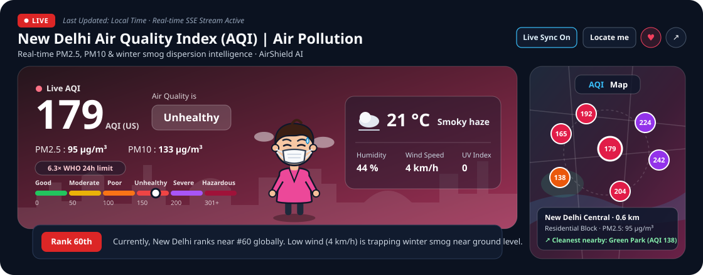

<div align="center">

# 🛡️ AirShield AI — Urban Air Quality & Winter Smog Assistant

**PromptWars Challenge 6 Submission** · GenAI-powered full-stack web application helping families and communities navigate severe winter smog and urban air pollution with low-emission daily routines, indoor air quality hacks, sustainable alternatives, and transparent impact quantification.

[](https://www.typescriptlang.org/)
[](https://react.dev/)
[](https://expressjs.com/)
[](./SECURITY.md)
[](#accessibility--inclusive-design-wcag-22-aa)
[-16a34a)](#testing--verification)

</div>

---

## 📸 Live Dashboard & Mascot Preview



### 🎭 Dynamic AirShield AI Mascot States
The built-in vector mascot (`src/components/AqiMascotSvg.tsx`) adapts dynamically to real-time air quality severity so families—including kids and seniors—can understand air risk at a glance alongside explicit text labels and numeric AQI ranges:


---

## 🗺️ Problem Statement Requirement → Code Mapping

| Problem Statement Requirement | Implementing Code |
| --- | --- |
| **Navigate severe winter smog & urban air pollution (live location-tailored intelligence)** | `server/services/airQualityService.ts`, `server/services/airQuality/aqiAnalytics.ts` (EPA AQI, safest 2h window, thermal inversion risk), `server/services/airQuality/fallbackProvider.ts` (hyperlocal stations & offline resilience), `src/components/AtmosphericHeroBanner.tsx`, `src/components/HyperlocalAqiMap.tsx`, `src/components/ForecastChart.tsx` |
| **Low-emission daily routines tailored to location & lifestyle** | `server/ai/builders/commute.ts`, `server/ai/prompts.ts`, `src/components/HouseholdProfileForm.tsx`, `src/components/ActionPlanView.tsx`, `src/components/RecommendationCard.tsx` |
| **Indoor air quality (IAQ) hacks (HEPA & low-cost DIY Corsi-Rosenthal filtration)** | `server/ai/builders/indoorAir.ts`, `server/ai/localChatEngine.ts`, `shared/constants.ts` (`PLEDGE_ACTIONS`) |
| **Sustainable alternatives (clean cooking, low-VOC home care, clean mobility)** | `server/ai/builders/cooking.ts`, `server/ai/builders/commute.ts`, `src/components/ImpactSimulator.tsx`, `src/components/PledgeActionCard.tsx` |
| **Community & family-focused action (Family, School PTA, Neighborhood RWA briefs)** | `server/ai/builders/community.ts`, `server/ai/localPlanEngine.ts` (copyable/printable RWA/PTA smog alert), `src/components/ActionPlanView.tsx` |
| **Clearly explain the direct impact of choices (personal health + community emissions)** | `server/services/impactCalculator.ts` (multiplicative PM2.5 reduction, cigarette parity, CO₂/PM2.5/tree scaling), `src/components/ImpactSimulator.tsx`, `src/components/RecommendationCard.tsx` |
| **GenAI-powered assistant (structured plans + conversational Q&A)** | `server/ai/llmClient.ts`, `server/ai/geminiClient.ts` (Gemini 2.5 Flash + bounded retry + Zod validation), `server/ai/prompts.ts`, `server/ai/promptGuard.ts`, `server/services/aiAdvisorService.ts`, `src/components/AdvisorChat.tsx` |
| **Real-time live updates & responsive UX** | `server/controllers/airQualityController.ts` (`/api/air-quality/stream` SSE + serverless auto-retry), `src/hooks/useLiveAirQualityStream.ts`, `src/components/LiveStatusHeader.tsx` |

---

## 🏗️ Layered System Architecture

```text
┌──────────────────────────────────────────┐     REST + Live SSE     ┌───────────────────────────────────────────┐
│        Frontend UI (src/ — React 19)     │ ◄─────────────────────► │       API Layer (api/ + server/)          │
│  • components/ (Hero, Map, Chart, Chat)  │                         │  • app.ts (Helmet CSP, CORS, X-Request-Id)│
│  • hooks/ (SSE, Favorites, Clipboard)    │                         │  • routes/api.ts (rate limiters)          │
│  • lib/apiClient.ts (Abort timeout)      │                         │  • controllers/ (health, AQ, advisor, sim)│
└──────────────────────────────────────────┘                         └─────────────────────┬─────────────────────┘
                                                                                           │
                    ┌───────────────────────────────────┬──────────────────────────────────┼───────────────────────────────┐
                    ▼                                   ▼                                  ▼                               ▼
       ┌─────────────────────────┐         ┌─────────────────────────┐        ┌─────────────────────────┐     ┌─────────────────────────┐
       │ config/ & utils/        │         │ services/ (Domain)      │        │ ai/ (Isolated GenAI)    │     │ shared/ (Contracts)     │
       │ • env.ts (Zod env)      │         │ • airQualityService.ts  │        │ • llmClient.ts (iface)  │     │ • types.ts              │
       │ • constants.ts          │         │ • aiAdvisorService.ts   │        │ • geminiClient.ts       │     │ • schemas.ts (Zod I/O)  │
       │ • logger.ts (JSON)      │         │ • impactCalculator.ts   │        │ • prompts.ts + guard.ts │     │ • constants.ts          │
       │ • errors.ts (AppError)  │         │ • cacheService.ts (LRU) │        │ • schemas.ts + builders │     └─────────────────────────┘
       └─────────────────────────┘         └─────────────────────────┘        └─────────────────────────┘
```

---

## 🚀 Quick Start

### Prerequisites
- **Node.js `22.x` LTS** (pinned in `package.json` `engines`)

### 1. Clone & Install
```bash
git clone https://github.com/newcoder-available/-PromptWars_Challenge-6-_Urban_Air_Quality_Assistant.git
cd -PromptWars_Challenge-6-_Urban_Air_Quality_Assistant
npm install
```

### 2. Environment Variables
Copy `.env.example` to `.env` and configure as needed:

| Variable | Default | Required | Purpose |
| --- | --- | --- | --- |
| `PORT` | `3001` | No | HTTP server port (self-hosted / Docker) |
| `NODE_ENV` | `development` | No | Runtime mode (`development` / `production` / `test`) |
| `ALLOWED_ORIGINS` | localhost dev origins | Prod | Comma-separated CORS allowlist (Vercel URLs auto-trusted) |
| `GEMINI_API_KEY` | *(empty)* | Optional | Server-side Google Gemini API key. If omitted, the built-in **AirShield Local Domain Engine** runs automatically |
| `GEMINI_MODEL` | `gemini-2.5-flash` | No | Allowlisted Gemini model identifier |
| `OFFLINE_MODE` | `false` | No | Set `true` to disable external Open-Meteo/Gemini fetches and use deterministic winter-smog fixtures |

### 3. Run Locally
```bash
npm run dev
```
- **Web App:** `http://localhost:5173`
- **API Server:** `http://127.0.0.1:3001`

### 4. Production Build & Start
```bash
npm run build
NODE_ENV=production npm start
```

### 5. Deploy on Vercel
Includes [vercel.json](./vercel.json) and serverless Express entrypoint [api/index.ts](./api/index.ts) (Node `22.x`):
1. Import the GitHub repo into **Vercel** (`Framework: Vite`, auto-configured via `vercel.json`).
2. *(Optional)* Add `GEMINI_API_KEY` in **Project Settings → Environment Variables**.
3. Deploy — Vercel serves the SPA from `dist/client`, routes `/api/*` to `api/index.ts`, and uses serverless-safe SSE auto-retry (`retry: 45000`).

### 6. Secure Docker Deployment
```bash
docker build -t airshield-ai .
docker run -p 8080:8080 \
  -e ALLOWED_ORIGINS=http://localhost:8080 \
  -e GEMINI_API_KEY=your_gemini_api_key_here \
  airshield-ai
```

---

## 🔌 API Reference

| Method | Endpoint | Description |
| --- | --- | --- |
| `GET` | `/api/health` | Service readiness, active AI engine mode, and LRU cache telemetry |
| `GET` | `/api/cities/presets` | Curated winter-smog hotspot cities |
| `GET` | `/api/cities/search?q=<city>` | Validated global city geocoding lookup |
| `GET` | `/api/air-quality?lat=&lon=&name=&country=` | Live AQI, weather, hyperlocal stations, safest 2h window & inversion risk |
| `GET` | `/api/air-quality/stream?lat=&lon=...` | Real-time **Server-Sent Events (SSE)** stream |
| `POST` | `/api/advisor/plan` | Personalized GenAI action plan + direct health & community impact |
| `POST` | `/api/advisor/chat` | Context-grounded GenAI advisor chat with prompt-injection firewall |
| `POST` | `/api/impact/simulate` | Quantitative household & community emissions/exposure simulator |

---

## 🔐 Security Highlights

Full threat model in [SECURITY.md](./SECURITY.md):
- **HTTP Hardening:** Helmet strict CSP (`default-src 'self'`, `script-src 'self'`, `object-src 'none'`, `frame-ancestors 'none'`), `Permissions-Policy`, `X-Powered-By` disabled, sanitized `X-Request-Id` correlation headers.
- **CORS & DoS Controls:** Strict `ALLOWED_ORIGINS` allowlist with typed `CorsOriginError` (`403`), `16kb` JSON payload cap (`413`), and memory-bounded sliding-window rate limiting (`429` + `Retry-After`).
- **GenAI Guardrails:** Server-side API key isolation (`x-goog-api-key` header), prompt-injection screening (`server/ai/promptGuard.ts`), XML delimiter sandboxing on user & location fields (`server/ai/prompts.ts`), strict Zod output schema verification (`server/ai/schemas.ts`), bounded retry + timeout, and deterministic local fallback.
- **SSRF & Container Security:** Hardcoded trusted HTTPS origins (`server/config/constants.ts`), 0 `npm audit` vulnerabilities, and non-root multi-stage `Dockerfile`.

---

## ♿ Accessibility & Inclusive Design (WCAG 2.2 AA)

- **Keyboard Navigation:** Skip-to-main-content link, WAI-ARIA roving-tabindex `tablist` (`ArrowLeft`/`ArrowRight`/`Home`/`End`), and full keyboard WAI-ARIA `combobox`/`listbox` (`ArrowDown`/`ArrowUp`/`Enter`/`Escape`, `aria-activedescendant`, `role="option"`).
- **WCAG 2.2 AA Criteria:** Minimum `28×28px` / `32px` interactive target sizes (SC 2.5.8), `scroll-padding-top: 120px` so sticky headers never obscure focused elements (SC 2.4.11), and visible `:focus-visible` outlines.
- **Inclusive Visuals & Screen Readers:** Dark, Light, and **High-Contrast** theme modes, `prefers-reduced-motion` support, color-blind safe AQI badges (color + text + numeric range + icons), dedicated `sr-only` polite live announcements for async AI plans, and an expandable HTML data table backing the 24-hour SVG forecast chart.

---

## 🧪 Testing & Verification

```bash
npm run typecheck      # Strict TypeScript checks (api + client + server + shared)
npm run lint           # ESLint + typescript-eslint + react-hooks + jsx-a11y (0 warnings)
npm test               # 40 automated Vitest tests across 5 suites
npm run test:coverage  # V8 coverage report (91.4% stmts / 92.4% funcs / 92.8% lines)
npm audit              # Dependency vulnerability audit (0 vulnerabilities)
npm run build          # Production Vite bundle + NodeNext server compile
```

Continuous integration is defined in [.github/workflows/ci.yml](./.github/workflows/ci.yml) running dependency audit, strict typecheck, ESLint + a11y lint, Vitest coverage, and production/Vercel builds on every push and pull request.
